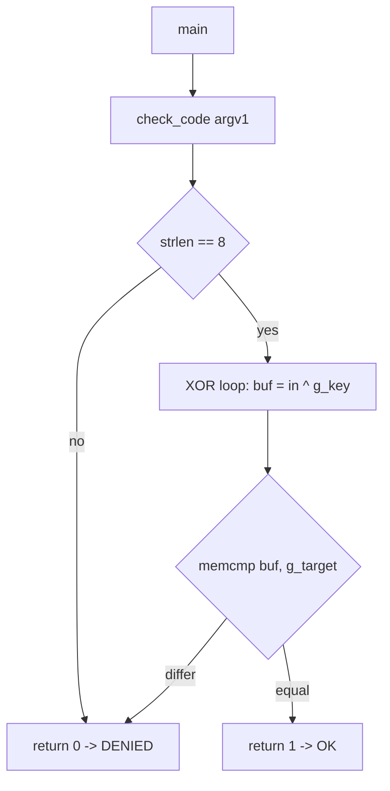

# ELF 离线样本静态分析报告

- case: elf-demo
- scope: `/workspace/work/elf-demo-src/sample`（自建测试样本，offline）
- primary: skills/ida-reverse/SKILL.md (R6) → 执行面缺失后切换 binutils
- sample sha256: aa15242b1043341822bb70d6684510659fdda7c8d98771007664e2544f5a9543

## 摘要

样本是一个 64 位 PIE、未 strip 的 ELF。入口逻辑位于 `check_code`，对输入做 8 字节 XOR
后与硬编码目标比较。密钥与目标常量同时存在于 `.data`，因此无需动态调试即可离线还原
合法输入 `MrQ_fcud`，并已在本机执行验证（`OK` / 错误输入 `DENIED`）。

## Finding

### F-001

- title: check_code 使用硬编码 XOR 密钥与目标常量，可离线还原合法输入
- severity: info
- status: validated
- confidence: high
- location: check_code @ 0x1189；g_key @ 0x4018；g_target @ 0x4010
- evidence_ids: [E-001, E-002, E-003, E-004]
- description: |
    `check_code` 先校验长度等于 8，再在 0x11b4 循环内执行 `buf[i] = in[i] ^ g_key[i]`，
    随后 `memcmp(buf, g_target, 8)` 并返回布尔值。密钥与目标均以明文常量存放在 `.data`，
    二者异或即可得到被接受的输入。
- impact: 本地校验型逻辑，无网络面；仅用于演示静态分析链路可完整还原判定条件。
- repro: 见 E-003 / E-004 的 repro_command。

## Path

### P-001

- path_type: callflow
- evidence_ids: [E-002, E-003, E-004]
- description: |
    main → check_code → strlen 长度门（==8）→ XOR 循环（g_key）→ memcmp（g_target）→ sete 返回

## 工具与门禁记录

- `tool-index.md`: ida/r2/ghidra 均为 no；未执行 bootstrap（会联网安装，IDA 为商业许可）
- 等价切换：`/usr/bin/objdump`、`/usr/bin/readelf`、`/usr/bin/strings`、`/usr/bin/gdb`
- 证据见 E-005

## 结论

判定条件完全由静态常量决定，样本不具备抗静态分析设计。该结论仅适用于本自建样本，
不外推到其他目标。
